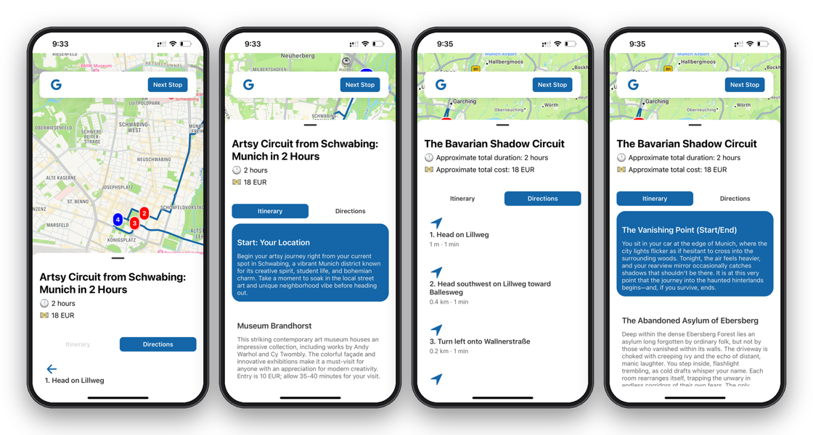
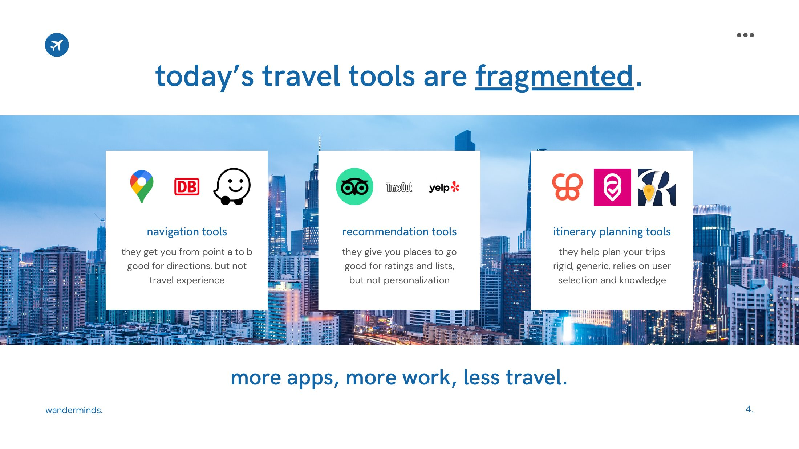
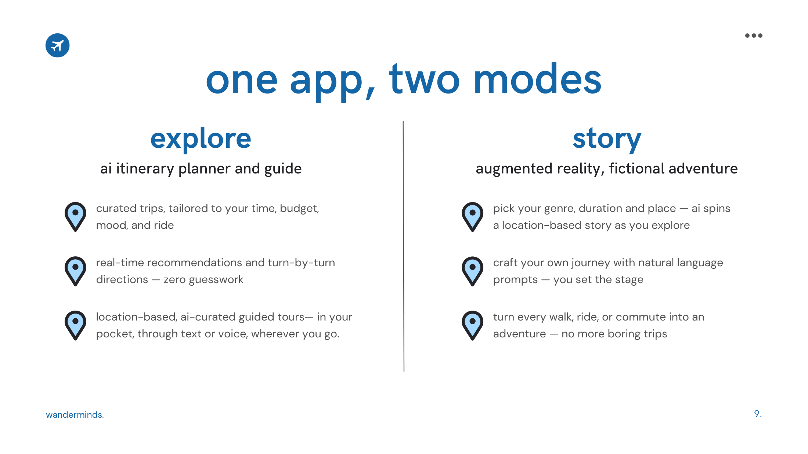
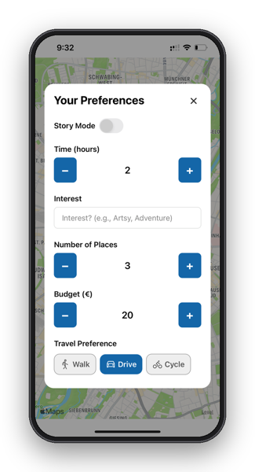
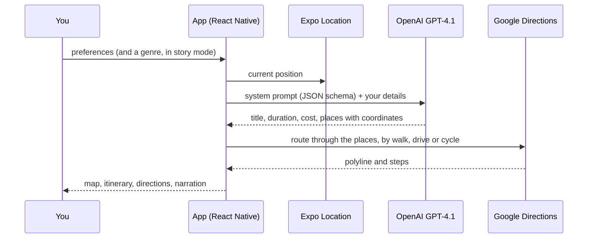

<div align="center">

# wanderminds

**Exploration reimagined, one adventure at a time.**<br>
An AI travel companion for your phone. Tell it how long you have, what you're into, your budget
and how you're getting around; it plans a short trip from where you stand, draws the route, talks
you through each stop, and can turn the whole walk into a story. Built in one weekend at the
TUM.ai Makeathon 2025 in Munich.

**[Pitch deck (PDF)](docs/wanderminds-pitch.pdf)** · [Original repository and history](https://github.com/AlyssaPng/wanderminds-Makethon-2025)

[](https://github.com/sp4ce-cowboy/wanderminds/blob/fab9d975a66c29973dc4231b0daf19e0303a0051/wanderMinds/app/screens/ExplorerScreen.tsx#L173-L224)
[](https://github.com/sp4ce-cowboy/wanderminds/blob/fab9d975a66c29973dc4231b0daf19e0303a0051/wanderMinds/app.config.js)
[](https://github.com/sp4ce-cowboy/wanderminds/blob/fab9d975a66c29973dc4231b0daf19e0303a0051/wanderMinds/app/utils/api.ts)
[](https://github.com/sp4ce-cowboy/wanderminds/blob/fab9d975a66c29973dc4231b0daf19e0303a0051/wanderMinds/app/screens/ExplorerScreen.tsx#L196-L211)
[](https://github.com/sp4ce-cowboy/wanderminds/blob/fab9d975a66c29973dc4231b0daf19e0303a0051/wanderMinds/app/screens/ExplorerScreen.tsx#L345-L405)
[](https://github.com/sp4ce-cowboy/wanderminds/blob/fab9d975a66c29973dc4231b0daf19e0303a0051/wanderMinds/app/screens/ExplorerScreen.tsx#L148-L169)


</div>

> [!NOTE]
> This consolidated README page was added by
> [Claude Opus 5.5](https://docs.anthropic.com/en/docs/claude-code) in Nov 2026 using my
> [agentic-repo-analysis](https://github.com/sp4ce-cowboy/agentic-workflows) skill, from the
> project's code, git history and the team's pitch deck. The project itself is from Apr 2025. This
> repository holds the team's final code as presented; the full commit history is in
> [the original repository](https://github.com/AlyssaPng/wanderminds-Makethon-2025). The technical write-up is in **[ARCHITECTURE.md](ARCHITECTURE.md)**.

<p align="center">
  
</p>

## At a glance

| | |
|---|---|
| **What** | An AI-powered travel assistant that recommends, guides and immerses you in your travels, in real time, from one app |
| **Context** | [TUM.ai](https://www.tum-ai.com) Makeathon 2025, Munich, April 2025: a weekend AI hackathon, during my NUS Overseas Colleges year in Munich |
| **Team** | [Alyssa Png](https://github.com/AlyssaPng), [maiyasaliha](https://github.com/maiyasaliha), Julian Tham and [Rubesh Suresh](https://github.com/sp4ce-cowboy) |
| **My role** | Shared across the team, from everyone's laptops and accounts. I worked across the explore flow: the preference steppers, the map with its route, directions and steps, the voice narration, and, with the team, the prompts that turn preferences into a route |
| **Stack** | React Native and Expo (TypeScript), react-native-maps and the Google Directions API, OpenAI GPT-4.1, Expo Location and Speech |
| **Next** | A native rewrite in Swift is planned, with an eye on the App Store |

## The problem

<p align="center">
  
</p>

Planning a day out means juggling a navigation app, a recommendations app and an itinerary
planner. None of them knows how much time you have, and none of them makes the walk itself
interesting. The pitch put it as "more apps, more work, less travel": travellers end up
overwhelmed, disconnected from the places they pass, or simply bored.

## What it does

<p align="center">
  
</p>



- **Tell it what you want.** Time (hours), an interest in your own words, how many places, a budget
  in euros, and walk, drive or cycle.
- **Explore mode.** It plans a loop from your current location and back, with the stops ordered to
  keep the total distance short: a title, a total time and cost, and a short description of each
  stop.
- **Story mode.** Switch it on, pick a genre, and every stop becomes a chapter of a fictional
  adventure set in the real places around you.
- **Get there.** The route is drawn on the map for your way of travelling, with turn-by-turn steps,
  a **Next Stop** button, and a hand-off to Google Maps.
- **Listen.** Each stop's description or story is read aloud in a Siri voice as you arrive.

<br clear="right"/>

## How it works



More in [ARCHITECTURE.md](ARCHITECTURE.md): the prompt design, the route and directions pipeline,
the bottom-sheet UI, and what a Swift version would change.

## Skills shown

| Skill | Where it shows (click the links for the code) | Docs |
|---|---|---|
| **Mobile development**<br> | The explore flow: preferences, location permission, the AI call and state hand-off: [`handleAdventureStart`](https://github.com/sp4ce-cowboy/wanderminds/blob/fab9d975a66c29973dc4231b0daf19e0303a0051/wanderMinds/app/screens/ExplorerScreen.tsx#L173-L224) | [React Native](https://reactnative.dev) |
| **Prompt engineering**<br> | Two system prompts, factual and fictional, that force a strict JSON schema with coordinates, a round trip and a distance-minimising order: [prompts](https://github.com/sp4ce-cowboy/wanderminds/blob/fab9d975a66c29973dc4231b0daf19e0303a0051/wanderMinds/app/screens/ExplorerScreen.tsx#L196-L211); the client: [`generateItinerary`](https://github.com/sp4ce-cowboy/wanderminds/blob/fab9d975a66c29973dc4231b0daf19e0303a0051/wanderMinds/app/utils/api.ts#L11-L29) | [Chat Completions](https://platform.openai.com/docs/api-reference/chat) |
| **Maps & navigation**<br> | Route drawing with react-native-maps-directions, camera fitting, and turn-by-turn steps parsed from the Directions API: [directions](https://github.com/sp4ce-cowboy/wanderminds/blob/fab9d975a66c29973dc4231b0daf19e0303a0051/wanderMinds/app/screens/ExplorerScreen.tsx#L345-L405) | [Directions API](https://developers.google.com/maps/documentation/directions/overview) |
| **Location & speech**<br> | Narration of each stop with a Siri voice: [`Speech.speak`](https://github.com/sp4ce-cowboy/wanderminds/blob/fab9d975a66c29973dc4231b0daf19e0303a0051/wanderMinds/app/screens/ExplorerScreen.tsx#L148-L169) | [Expo Speech](https://docs.expo.dev/versions/latest/sdk/speech/) |
| **Product thinking** | A problem, a two-mode concept and a demo, pitched to judges in a weekend: [pitch deck](docs/wanderminds-pitch.pdf) | — |

## Coding stats

From git, for the whole team. The weekend wasn't tracked in WakaTime.

| | |
|---|---|
| **Built in** | about 21 hours of commits, from Saturday 15:44 to Sunday 12:30 (26 – 27 Apr 2025, Munich time) |
| **Commits** | 52, across 5 branches |
| **Code** | about 1,250 lines of TypeScript across the app's screens and helpers |

## On my resume

**Skills:** React Native · Expo · TypeScript · prompt engineering (OpenAI) · Google Maps Directions API · location services · text-to-speech · rapid prototyping · product pitching

- Co-built wanderminds at the TUM.ai Makeathon 2025 in Munich: an AI travel companion in React Native and Expo that plans a personalised round trip from the user's location and guides them through it, from idea to working iPhone demo and pitch in one weekend.
- Co-designed GPT-4.1 prompts that turn time, interest, budget, stop count and travel mode into strict JSON itineraries with coordinates, ordered to minimise total distance and starting and ending at the user's position, plus a story mode that rewrites each stop as a chapter in a chosen genre.
- Built the route experience on react-native-maps: Google Directions polylines for walking, driving or cycling, turn-by-turn steps parsed from the API with direction icons, a Next Stop flow, camera fitting, and a hand-off to Google Maps.
- Added hands-free guidance with Expo Speech, narrating each stop in a Siri voice as the traveller arrives.

## Getting started

```sh
cd wanderMinds
npm install
# .env with OPENAI_API_KEY and GOOGLE_MAPS_API_KEY (read by app.config.js)
npx expo start   # then press i for the iOS simulator
```
